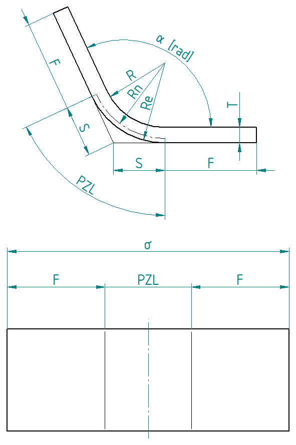

## About
Library is a replacement of standard bending development formula for Solid Edge. In material properties You can assign emet.pzl and make flat patterns compatible with Your bending tables without changing bending radii in original 3D models. Works even if 3D-model radii are wrong and if 3D-model thickness is wrong. Formulas are based on compensated PZL-zone length and fake K-factors.
Library is developed and extensively tested at the Polish "emet" company which makes sheet metal equipment. 

## Installation
Library must be registered in Windows. Here is command:
%SystemRoot%\Microsoft.NET\Framework64\v4.0.30319\regasm /codebase "c:\path\to\emet.dll"
Library requires bending table (emet.xlsx) in the same directory.

## Maths
### Variable definitions
D: deduction  
…m: variable from 3D model  
…t: variable from bending tables  

### Axioms

K=(Rn-R)/T [ANSI]  
σ=2×S+2×F-D  
PZL=α×Rn  
S=Re×Tan(α/2)

### Derived equations
F=0 (hypothetical simplification) ⇒ σ=2×S-D=PZL    
D=2×S-PZL  

S=Re×Tan(α/2), Re=R+T ⇒ S=(R+T)×Tan(α/2)  
Rn=R+T×K, PZL=α×Rn ⇒ PZL=α×(R+T×K)  

PZL-α×R=α×K×T | /(α×T)  
K=(PZL-α×R)/(α×T)  
K=(PZL/α-R)/T

### PZL Compensation
- Reducing 3D Model PZL to 0
- Calculating PZL that compensates radius difference (PZLc)

Dmopzl: Deduction from 3D model with PZL reduced to 0  
Dmopzl=2×Sm  
Dt=2×St-PZLt  
PZLc=Dmopzl-Dt  
PZLc=2×Sm-(2×St-PZLt)  
PZLc=2×Sm-2×St+PZLt  
PZLc=2×(Rm+Tm)×Tan(α/2)-2×(Rt+Tt)×Tan(α/2)+α×(Rt+Tt×K)

**PZLc=2×Tan(α/2)(Rm-Rt+Tm-Tt)+α×(Rt+Tt×K)**

### Fake K-factor
When this factor is used in the standard bend-development formula we've got good flat pattern even if 3D Model thickness or 3D model radii differs from bending tables. K-factor results from compensated PZL which can be 0. So fake K-factor can be outside reasonable range (0,1>  

K=(PZL/α-R)/T  
**Kfake=(PZLc/α-Rm)/Tm**  

## Disclaimer
These scripts and tools are provided "AS IS", without any warranty of any kind. Use them at your own risk.
Always create backups of your files before running any script or tool. The author shall not be held liable for any data loss, file corruption, damage, or other consequences resulting from the use or misuse of the provided software.
This project is an independent, community-developed project and is not affiliated with, endorsed by, or officially supported by Siemens or Solid Edge.
Solid Edge is a trademark of Siemens and/or its affiliates.
